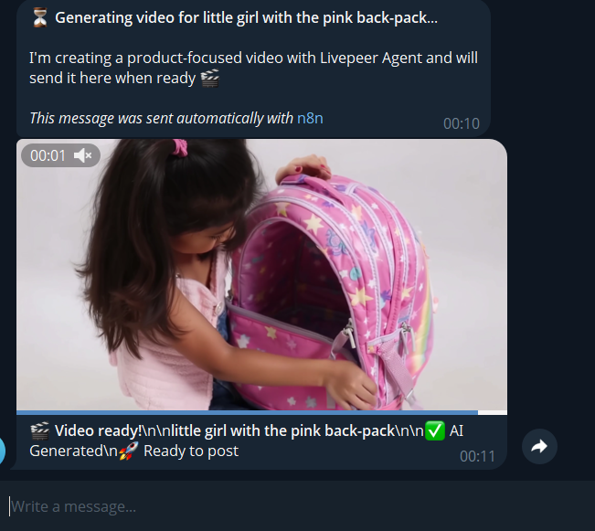

# AI Product Video Generator with Livepeer + n8n


Turn a product image and a simple text prompt into a short AI-generated product video — directly from Telegram.

This project combines **n8n**, **Livepeer Agent / Creative MCP**, **Anthropic Claude**, and **Telegram** to automate the complete product-video generation workflow.

## Demo

> Send a product image with a `/generate` command in Telegram and receive the generated product video automatically.

### Example

```text
/generate Pink Backpack | Create a short product-focused promotional video showing a child using this backpack.
```

The workflow:

```text
Product Image + Prompt
        ↓
      Telegram
        ↓
        n8n
        ↓
Generate UGC Script with Claude
        ↓
Upload Product Image to Livepeer
        ↓
Livepeer Agent
        ↓
AI Video Generation
        ↓
Download Generated MP4
        ↓
      Telegram
        ↓
   Ready-to-Post Video
```

---

## Features

- 🖼️ Accepts product images directly through Telegram
- 💬 Uses a simple `/generate` command
- 🤖 Generates a short UGC-style product script with Claude
- 🎬 Generates an AI product video using Livepeer Agent
- ⚡ Uses Livepeer's `ltx-25-i2v-fast` capability
- 📥 Downloads the generated MP4 automatically
- 📤 Sends the finished video back to Telegram
- 🔒 No API keys or bot tokens are hardcoded in this repository
- 🔄 Includes session locking to prevent duplicate generation requests
- ⏱️ Automatically clears stale sessions
- 🧩 Built entirely around an n8n workflow

---

# Architecture

```text
                         ┌──────────────────┐
                         │     Telegram     │
                         │  Image + Prompt  │
                         └────────┬─────────┘
                                  │
                                  ▼
                         ┌──────────────────┐
                         │       n8n        │
                         │ Workflow Engine  │
                         └────────┬─────────┘
                                  │
                     ┌────────────┴────────────┐
                     │                         │
                     ▼                         ▼
             ┌───────────────┐       ┌─────────────────┐
             │    Claude     │       │  Livepeer MCP   │
             │ Script Writer │       │   Image Upload  │
             └───────┬───────┘       └────────┬────────┘
                     │                        │
                     └────────────┬───────────┘
                                  ▼
                         ┌──────────────────┐
                         │  Livepeer Agent  │
                         │ Video Generation │
                         └────────┬─────────┘
                                  │
                                  ▼
                         ┌──────────────────┐
                         │   Generated MP4  │
                         └────────┬─────────┘
                                  │
                                  ▼
                         ┌──────────────────┐
                         │     Telegram     │
                         │   Video Output   │
                         └──────────────────┘
```

---

# How It Works

## 1. User sends a product image

The Telegram bot expects a `/generate` command together with a product photo.

Example:

```text
/generate Nivea Cream | Winter skincare cream
```

The product image must be attached to the same Telegram message.

---

## 2. n8n validates the request

The workflow checks:

- Telegram chat ID
- Product name
- Product description
- Product image
- Existing generation session

A session lock is used to prevent a user from accidentally starting multiple generations at the same time.

Sessions automatically expire after 30 minutes.

---

## 3. Product image is downloaded

The Telegram image is downloaded into n8n as binary data.

The workflow checks the image size before sending it to Livepeer.

The current workflow limits the uploaded image to approximately **3 MB**.

---

## 4. Image is uploaded to Livepeer

The image is sent to Livepeer's Creative MCP upload tool.

Livepeer returns an accessible HTTPS URL for the uploaded image.

That URL is then used as the source image for video generation.

---

## 5. Claude generates the UGC script

Anthropic Claude generates a concise product-focused script.

The script is designed to include:

- A strong hook
- Natural human speech
- Conversational language
- Product-focused messaging
- Visual actions
- A call to action

The generated script is then passed to the Livepeer generation step.

---

## 6. Livepeer generates the video

The workflow calls Livepeer Agent using the:

```text
ltx-25-i2v-fast
```

capability.

The product image and generated script are supplied as the creative direction.

The workflow currently requests a **6-second video**.

---

## 7. n8n retrieves the generated video

The workflow extracts the MP4 URL returned by Livepeer.

It then downloads the video into n8n as binary data.

---

## 8. Telegram receives the final video

The generated MP4 is sent back to the same Telegram chat.

The user receives a message similar to:

```text
🎬 Video ready!

Pink Backpack

✅ AI Generated
🚀 Ready to post
```

---

# Requirements

Before importing the workflow, you need:

- [n8n](https://n8n.io/)
- A Telegram Bot
- A Telegram API credential in n8n
- An Anthropic API credential
- Livepeer Agent / Creative MCP access
- Appropriate Livepeer authentication

---

# Installation

## 1. Download the workflow

Download:

```text
UGC_Automation_Livepeer_GitHub_SAFE.json
```

from this repository.

---

## 2. Import into n8n

Open your n8n instance and:

1. Go to **Workflows**
2. Select **Import from File**
3. Select the downloaded JSON file
4. Open the imported workflow

The public workflow intentionally does not contain the original credentials.

You must configure your own credentials after importing it.

---

# Credential Setup

## Telegram

Create a Telegram bot using BotFather.

Then create an n8n Telegram credential using your own bot token.

Attach the credential to the Telegram nodes, including:

- `Telegram Trigger`
- `Get Telegram File Info`
- `Send Processing Message`
- `Send Livepeer Video`
- `Send Parse Error`
- `Livepeer Error Msg`

---

## Anthropic

Create an Anthropic API credential in n8n.

Attach it to:

```text
Generate Script
```

The workflow uses:

```text
Claude Sonnet 4.6
```

for script generation.

---

## Livepeer

Configure your own Livepeer authentication in n8n.

Attach your Livepeer authentication credential to the Livepeer MCP nodes:

```text
Livepeer Agent — Upload Image
Livepeer Agent — Run Capability
```

Do not hardcode your Livepeer API key into the workflow.

---

# Usage

Once the credentials are configured and the workflow is active:

### Send:

```text
/generate Pink Backpack | Create a fun product-focused video showing a child using this backpack.
```

Attach the product image to the same Telegram message.

The workflow will automatically:

```text
Receive image
      ↓
Validate request
      ↓
Upload image
      ↓
Generate script
      ↓
Generate video
      ↓
Download MP4
      ↓
Send video to Telegram
```

---

# Commands

## Generate

```text
/generate Product Name | Description
```

Example:

```text
/generate Pink Backpack | A colorful school backpack for children aged 5 to 10.
```

Attach the product image.

---

## Reset

```text
/reset
```

Clears the current Telegram session and allows a new generation request.

---

# Workflow Nodes

The main workflow components include:

| Node | Purpose |
|---|---|
| Telegram Trigger | Receives Telegram messages and images |
| Parse Message | Validates commands, images and sessions |
| New Generate Request? | Routes valid generation requests |
| Get Telegram File Info | Retrieves the Telegram image |
| Prepare Livepeer Image Upload | Converts the image for Livepeer |
| Livepeer Agent — Upload Image | Uploads the product image |
| Extract Livepeer Upload URL | Gets the Livepeer image URL |
| Store Session | Stores generation state |
| Send Processing Message | Notifies the user |
| Generate Script | Creates the UGC script with Claude |
| Extract Script | Extracts the generated script |
| Livepeer Agent — Run Capability | Generates the AI video |
| Extract Livepeer Video URL | Extracts the generated MP4 URL |
| Download Livepeer MP4 | Downloads the generated video |
| Send Livepeer Video | Sends the video to Telegram |
| Unlock After Livepeer | Clears the active session |

---

# Security

This repository intentionally does **not** contain production credentials.

Never commit:

```text
API keys
Bot tokens
OAuth tokens
Private keys
Bearer tokens
.env files
n8n credential exports
```

Use n8n's credential system instead.

If you accidentally expose an API key, revoke and rotate it immediately.

---

# Important Notes

### Livepeer access

You need your own Livepeer access and authentication to use the Livepeer MCP endpoints.

### Anthropic usage

The script-generation step uses Anthropic and therefore requires your own API access.

### Telegram

Each user must interact with a Telegram bot that you control.

### Video generation

Generation time depends on the Livepeer service and the selected generation capability.

### Costs

This workflow uses third-party services that may incur usage charges.

Check the current pricing and usage policies of the services you connect before running this at scale.

---

# Why n8n?

n8n acts as the orchestration layer connecting the different services.

Instead of manually:

```text
Upload image
     ↓
Write script
     ↓
Call video model
     ↓
Wait for result
     ↓
Download video
     ↓
Send video
```

the entire process is automated:

```text
Product + Prompt
       ↓
      n8n
       ↓
    AI Agent
       ↓
   Livepeer
       ↓
  Final Video
```

This makes the workflow easy to modify and extend with additional AI services, storage providers, publishing platforms, or approval steps.

---

# Possible Extensions

This workflow can be extended to support:

- Instagram publishing
- TikTok publishing
- YouTube Shorts
- Facebook Reels
- Multiple video variations
- Voice-over generation
- AI-generated captions
- Background music
- Product descriptions
- Automated ad copy
- Content approval workflows
- Cloud storage
- Batch product generation
- Scheduled publishing

---

# Project Status

🚧 **Experimental / Hackathon Project**

This project was created to explore automated AI-powered product video generation using Livepeer Agent and n8n.

It is not intended to be considered production-ready without additional testing, rate limiting, cost controls, error handling, and security hardening.

---

# Built With

- [n8n](https://n8n.io/)
- [Livepeer](https://livepeer.org/)
- [Anthropic](https://www.anthropic.com/)
- [Telegram](https://telegram.org/)

---

# License

Add your preferred license here.

For example:

```text
MIT License
```

See `LICENSE` for details.

---

# Author

**Aloysius Samuel**

Building AI-powered automation and SaaS infrastructure with n8n, AI agents and modern web technologies.

- Website: https://seltechai.com/
- LinkedIn: https://www.linkedin.com/in/samuel-aloysius-m/
- X: https://x.com/mascot75572
